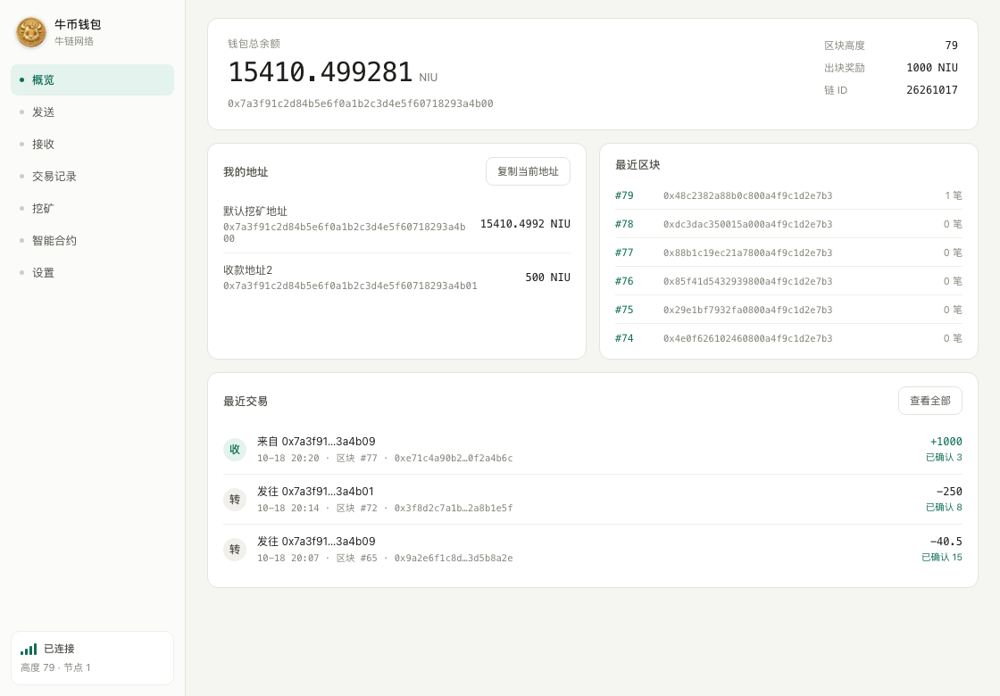
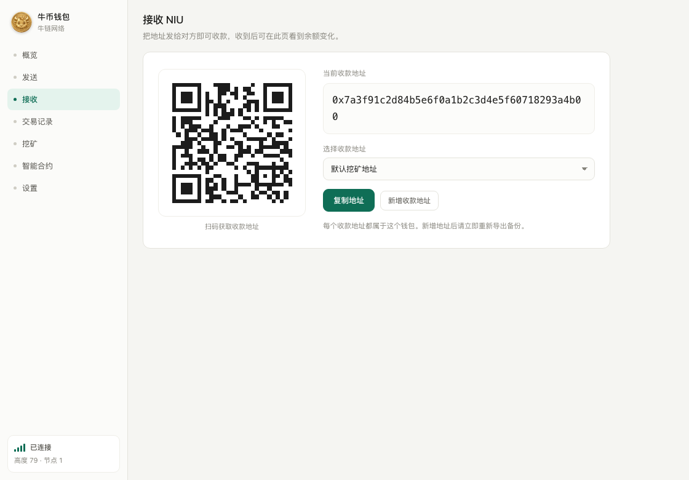
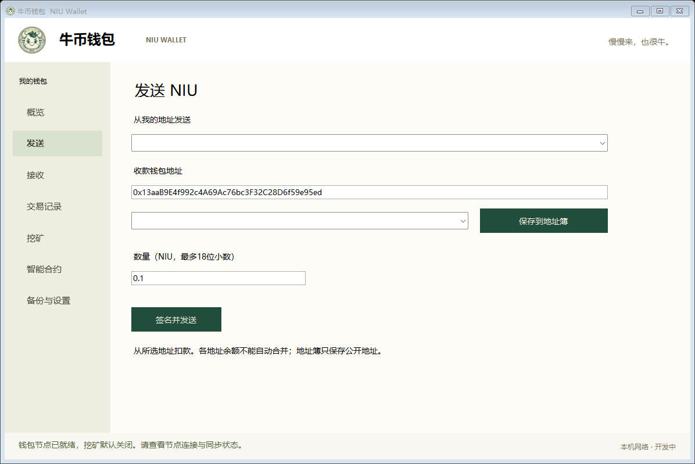
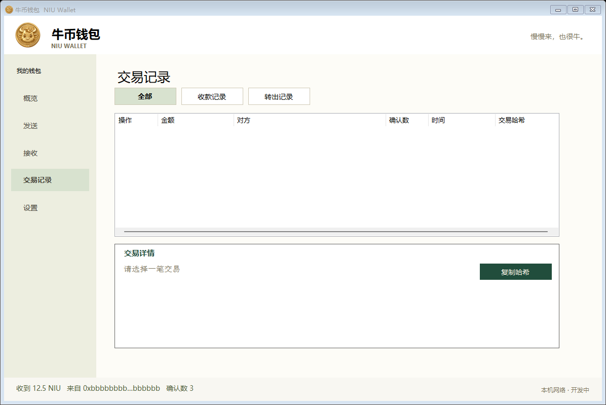
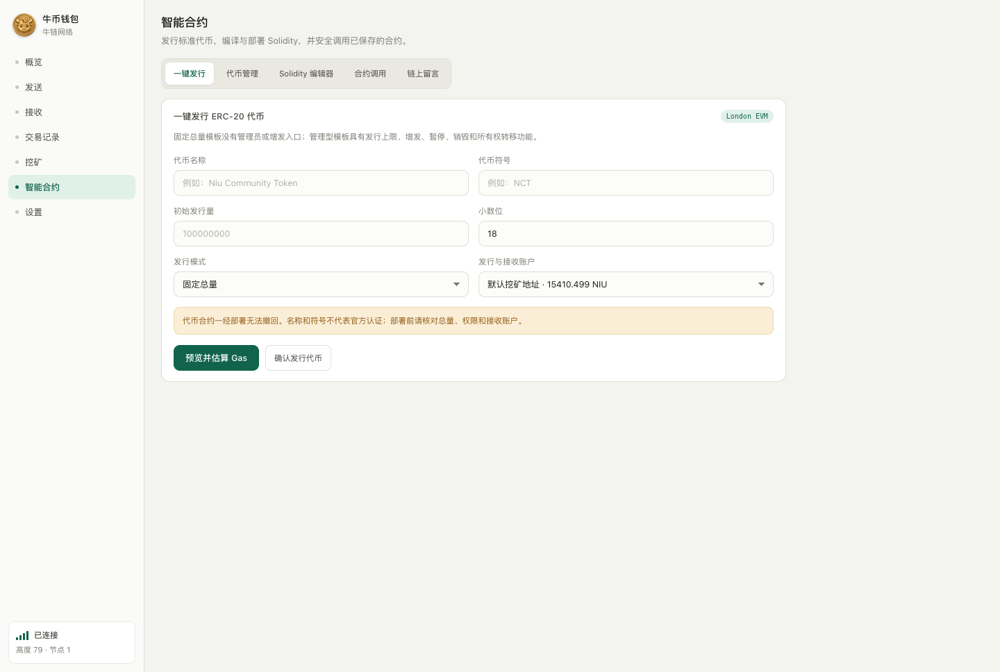
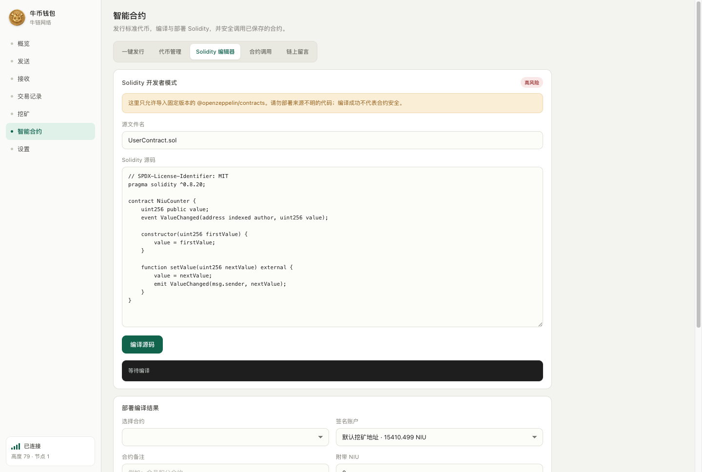

# 牛币钱包 NIU Wallet

牛币钱包是牛链（NIU）桌面钱包。当前提供 Windows x64 与 macOS Apple Silicon（arm64）版本；两端均接入同一条 NIU 网络。

> **当前版本：** macOS 与 Windows 均为 `v0.3.10`。安装包在 [Releases](https://github.com/yuanhong792/niu-wallet/releases) 下载。项目仍处于早期阶段，未经独立第三方安全审计，也未完成 Apple 公证或商业代码签名，请先阅读 [SECURITY.md](SECURITY.md)。

### v0.3.10 更新

- 交易列表会自动识别 ERC-20 `transfer` 和 `transferFrom`，显示真实代币数量与符号，不再把 `0 NIU` 误解为没有转账。
- 交易详情优先使用已确认的链上 `Transfer` 事件，并显示代币合约、名称、精度、收发地址、最小单位数量和解析依据；原生 NIU 金额与 Gas 手续费仍单独保留。
- 支持根据代币合约自动读取元数据并缓存；无法验证元数据时明确标记，不把未知合约伪装成已验证代币。
- 账本扫描可识别 calldata 中的代币收款地址，已有合约交易也会自动补充代币明细。
- macOS 与 Windows 共用同一实现与六语言文案，本版本通过 25 项自动化回归测试。

[官方网站](https://yuanhong792.github.io/niu-wallet-site/) · [白皮书 V3.0](docs/牛链NIU白皮书V3.0.md) · [V3.0 Word](docs/牛链NIU白皮书V3.0.docx) · [技术白皮书 V2.0](docs/牛链NIU白皮书V2.0.md) · [安全状态](SECURITY.md)

## 网络参数

- 网络名称：牛链网络（NIU）
- Chain ID / Network ID：`26261017`
- 创世哈希：`0x9590d27e9e5977eb00bf1fd794d93fce0cac22dad04dc3f25fc072ab0c87e053`
- 初始区块奖励：`1000 NIU`
- 减半周期：每 `1,050,000` 个区块
- 小数位：18
- 共识：Ethash PoW；London EVM / Solidity 合约

钱包在本机运行节点并把链数据保存在用户目录，但默认会连接项目配置的共享节点，同步的是同一条网络历史。界面左下角会显示“已连接 / 同步中 / 未连接”、当前高度和节点数。只有连接到相同 Chain ID、创世哈希与共识规则的节点，余额和已挖区块才会在其他电脑上得到一致结果。

## 当前功能

- 概览：NIU 总余额、区块高度、节点连接、最近区块与最近交易。
- 发送：选择自己的付款地址，填写收款地址和金额，签名后广播交易。
- 接收：选择或新增收款地址，复制地址，并显示该地址的二维码。
- 交易记录：点击任意交易可展开完整链上明细；ERC-20 `transfer` / `transferFrom` 会自动解析代币符号、精度、数量和收发地址，并用链上 `Transfer` 事件核对结果，同时保留原生 NIU 金额、手续费与原始输入数据。
- 挖矿：在钱包中主动开启或停止 PoW 挖矿。
- 代币：一键发行固定总量或带上限的管理型 ERC-20，支持导入、查看余额和转账。
- Solidity 工作台：编辑、编译、估算 Gas 并部署 Solidity；支持导入 ABI，对已保存合约执行只读或签名写入调用。
- 钱包保护：签名类操作需要解锁，空闲约 5 分钟自动上锁。
- 备份与恢复：导出带独立密码的可携带 JSON 备份；导入时直接选择备份文件，明确区分当前钱包口令与备份密码。
- 六种界面语言：简体中文、English、日本語、한국어、Español、Русский。
- macOS 与 Windows 共用同一套 Electron 界面和钱包业务代码，页面布局、功能入口与语言设置保持一致。

## 钱包地址和备份

余额记录在链上，恢复钱包的关键是私钥，不是应用目录里的区块文件。请在“设置 → 导出备份”中创建可携带备份，并把备份文件和密码分开保管。项目方无法找回丢失的备份密码。

备份包含导出时钱包里的全部自有地址（最多 32 个）。新增收款地址以后必须重新导出备份，否则旧备份不包含新增地址的私钥。恢复后接入上面的同一网络并等待同步，余额会按链上状态重新出现。

- Windows：本机钱包文件由当前 Windows 用户的 DPAPI 保护。
- macOS：本机钱包文件使用 AES-256-GCM 加密，主密钥由当前 macOS 用户的钥匙串保护。
- 可携带备份：使用 ethers V3 keystore（scrypt + AES-128-CTR）和独立备份密码，可跨电脑恢复。

不要把 `wallet.dpapi`、JSON 备份、密码、私钥、助记材料或真实钱包数据提交到 GitHub。

## 安装

### macOS（Apple Silicon）

1. 从 Releases 下载 `NIU-Wallet-v0.3.10-macOS-arm64.dmg`，并用同一页面的 `.sha256` 文件核对 SHA-256。
2. 打开 DMG，把“NIU Wallet”拖入“应用程序”。
3. 当前版本未做 Apple 公证。首次启动如果被 macOS 拦截，请在 Finder 中右键应用并选择“打开”。
4. 升级应用不会删除 `~/Library/Application Support/NIU Wallet/` 中的钱包和链数据，但升级前仍应先导出可携带备份。

### Windows x64

1. 从 Releases 下载 `NIU-Wallet-v0.3.10-Windows-x64.zip` 并完整解压，不要只复制单个 EXE。
2. 双击文件夹中的 `NIU Wallet.exe`。
3. 当前版本未做商业代码签名；Windows SmartScreen 可能显示“未知发布者”。

## 共识实现与边界

定制节点对网络 `26261017` 执行：零创世分配、初始每块 1000 NIU、每 105 万块减半、18 位小数、无叔块及叔块奖励。整数舍入后的基础发行总额小于 21 亿。

难度候选沿用 Ethash/EIP-100 调整形状，使用 42 秒时间桶并禁用难度炸弹，目标平均约 60 秒。它不是固定 60 秒出块承诺；算力骤变、时间戳操纵、深度重组和长期运行仍需要更多独立验证。当前不是抗量子链。

## 上游与测试

节点基于 Core-Geth v1.12.23，起始提交 `96b2afc25c7023bb500d14e8ed69455339b1ca90`，保留上游版权和许可证。macOS 与 Windows 桌面端均使用 Electron，并复用同一套受本机回环地址保护的后端接口。

v0.3.10 已通过 25 项钱包回归测试、六语言静态覆盖检查；其中新增测试覆盖 ERC-20 `transfer`、`transferFrom`、链上 `Transfer` 事件解析和 calldata 收款识别。既有的真实双节点链 ERC-20 发行/转账与 Solidity 合约部署/读写验证继续保留。发布流程会分别构建 macOS arm64 DMG 和 Windows x64 ZIP，并生成 SHA-256 校验文件。当前 macOS 包为临时签名（ad-hoc），Windows 包未做商业代码签名。

安全状态、依赖扫描结论和仍未完成的验证见 [SECURITY.md](SECURITY.md)。

## 最新界面（v0.3.10）

以下截图使用公开演示数据生成，不包含真实用户地址、余额或备份资料。v0.3.10 保留 v0.3.9 的合约工作台布局，并增强交易记录中的 ERC-20 数量显示。

**概览**：NIU 总余额、当前地址、区块、连接状态和最近交易。

**接收**：选择或新增收款地址，并显示该地址的二维码。

**发送**：选择付款地址，输入收款地址和金额。

**交易明细**：点击交易即可查看并复制完整链上字段。

**设置、备份与导入**：导出可携带备份，或直接选择备份文件导入。

**一键发行 ERC-20**：选择固定总量或管理型模板，预览 Gas 后再确认部署。

**Solidity 编辑器**：编译 London EVM 合约、查看 ABI、估算 Gas 并部署；编译成功不代表合约已经过安全审计。

## 风险提示

本项目未经独立第三方安全审计，不适合存放无法承受损失的资产。程序更新、系统故障、密码遗失、恶意软件和错误网络配置都可能造成资产无法使用。请保留多份离线备份，并先用小额测试恢复流程。
