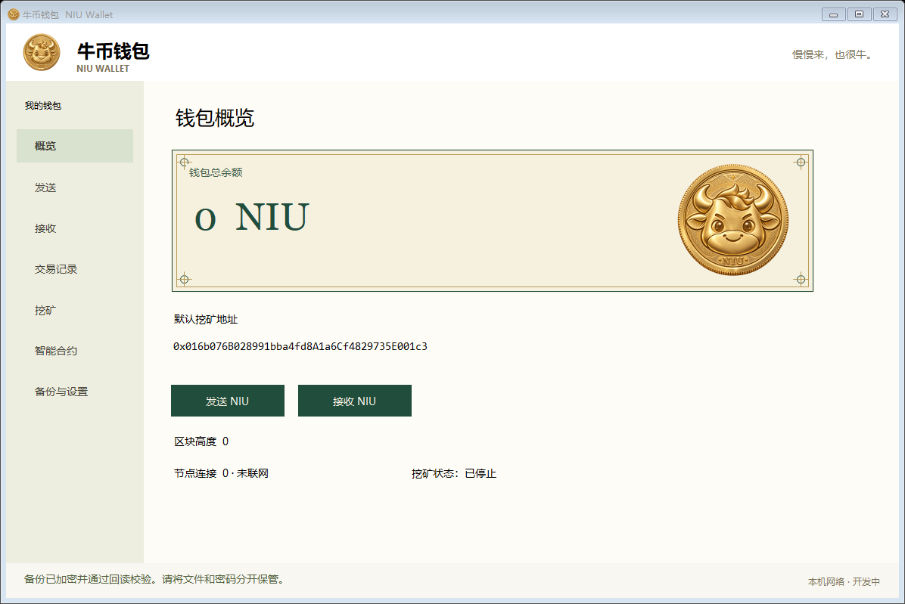

# 牛币钱包 NIU Wallet

牛币独立 Windows 钱包项目。当前源码处于集成验收阶段，本仓库提供源码和开发资料，尚未发布正式安装包。

> **发布阻断：** 原节点扫描的41条记录已完成逐条处理，复扫未发现可调用漏洞；[修复对照与扫描限制](docs/节点41条漏洞修复报告.md)。钱包口令锁与跨电脑验收尚未完成。当前仅提供源码，不发布正式安装包。详见 [安全状态](SECURITY.md)。

[白皮书 V2.0](docs/牛链NIU白皮书V2.0.md) · [PDF](docs/牛链NIU白皮书V2.0.pdf) · [Word](docs/牛链NIU白皮书V2.0.docx) · [构建与验收](docs/构建与验收.md)

## 当前具备的功能

- 六种界面语言：简体中文、English、日本語、한국어、Español、Русский；在“备份与设置”切换，即时生效并记住选择。
- 原生 Windows 图形界面：概览、发送、接收、交易记录、挖矿、智能合约、备份与设置。
- 首次创建自己的账户；新增收款地址、地址选择、收款二维码、复制地址、发送地址簿；可选择自己的发送账户。
- 本机运行节点，主动开启或停止 Ethash 挖矿；London EVM / Solidity 合约。
- 密码加密的可携带备份；首次启动可导入备份，恢复到全新目录，拒绝覆盖原钱包。
- 本机两节点模式，以及通过 network-config.json 显式选择的单节点互联模式。
- 展示节点连接、同步进度及交易确认数；已跟踪交易在重组后重新核对收据。

## 共识实现与完成边界

修改后的节点源码对集成网络 26261017 执行：零创世分配、初始每块1000 NIU、每105万块减半、18位小数、无叔块及其奖励。整数舍入后基础发行总额小于21亿。

难度候选沿用 Ethash/EIP-100 调整形状，使用42秒时间桶并禁用难度炸弹，目标平均约60秒。它不是固定60秒出块承诺；算力骤变、时间戳操纵和长期运行模拟仍须验收。当前不是抗量子链。

默认本机模式仍是旧实验网络26261015，奖励沿用上游，不与集成网络混用。朋友互联模式必须使用修改后节点、固定创世哈希和已核实的 enode，缺少配置或节点程序时拒绝启动。尚未部署公网引导节点，也未完成两台实体电脑的验收。源码构建步骤见 docs/构建与验收.md。

## 备份与同步

本机运行密钥由 Windows DPAPI CurrentUser 保护。可携带 JSON 备份使用 ethers 标准 V3 keystore 实现（scrypt N=131072/r=8/p=1，AES-128-CTR），需要独立密码；保存后会解密回读校验。文件与密码缺一不可，项目方不能找回密码。

备份包含本机全部账户（最多32个），不含链历史、完整交易记录和应用资料。备份到另一块存储介质，密码分开保管。恢复后连接同一网络并同步，以链状态恢复余额。可手动新增收款地址；新增后需要重新备份。

网络同步不发送私钥。RPC、矿工控制和钱包控制接口均保持本机访问；仅明确配置的 P2P 接口用于其他电脑连接，不自动修改防火墙。首轮静态节点由底层客户端维护连接；DNS种子和开放的节点发现尚未配置。

## 启动与发布

本项目暂不提供已上线的下载链接。后续正式包计划包含 NiuWallet.exe、Node.js、对应节点程序、依赖、许可证与实际对应源码，首次启动不自动挖矿，不携带开发者钱包或余额。

软件签名、独立安全审查、跨电脑互联、完整异常场景验收尚未完成。请勿把内部文件标注为正式发行版。

## 上游与构建

基于 Core-Geth v1.12.23，起始提交96b2afc25c7023bb500d14e8ed69455339b1ca90。保留上游版权和许可；改动见共识源码及测试。Windows桌面使用 .NET Framework / Windows Forms，二维码使用 QRCoder。Node依赖固定在package-lock.json。

源码：https://github.com/etclabscore/core-geth/tree/96b2afc25c7023bb500d14e8ed69455339b1ca90

运行模块验证：node --test scripts/network.test.mjs scripts/portable-vault.test.mjs scripts/restore-wallet.test.mjs
## 钱包界面

语言功能与验收说明见 [多语言界面](docs/多语言界面.md)。白皮书 V2.0 保留编写时的安全状态；后续41条扫描记录处理以[修复对照](docs/节点41条漏洞修复报告.md)为准。

首发预备包与第1个奖励区块的安排见[启动说明](docs/首发与第一区块.md)。本机私有预备包不属于公开正式发行。
