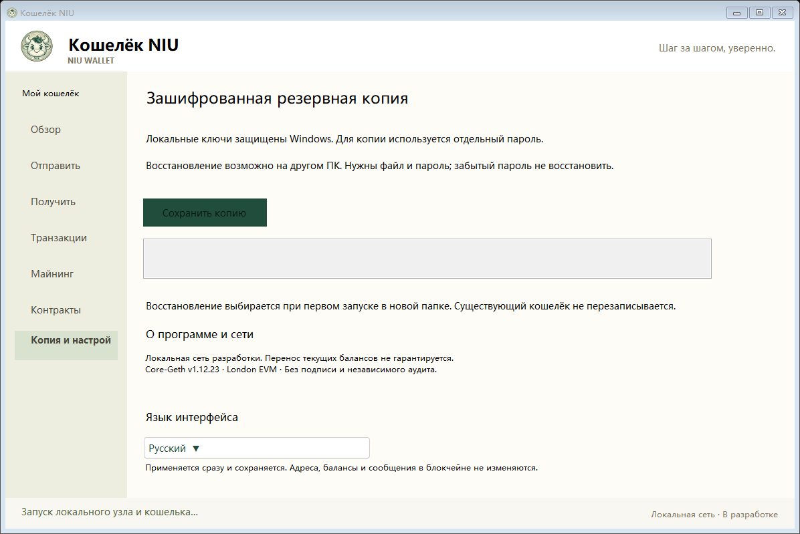

# 多语言界面

更新：2026-10-16。

支持简体中文、English、日本語、한국어、Español、Русский。在“备份与设置 → 界面语言”点击当前语言并选择，即时生效，不需要重启。

首次运行按 Windows 的界面语言选择；不支持的系统语言使用英语。选择保存在当前用户的 `%LOCALAPPDATA%\NIUWallet\preferences.json`，重启后保留。损坏、过大或不支持的配置不会被当作语言代码使用；保存失败会提示。

菜单、页面、交易状态、确认提示、备份密码和恢复对话框使用独立语言目录。联系人备注、收款地址标签、正在填写的地址/金额/留言、链上内容和密码不参与翻译。来自底层节点的原始诊断与日志保留原文，方便定位错误。

语言目录位于 `assets/locales/`，编译时嵌入 Windows 程序，运行时不需要联网获取翻译。新增或修改语言后需重新编译；仅替换外部 JSON 不改变已编译程序。没有自动翻译私钥、备份或用户输入的外部服务。

## 验证

- `node --test scripts/languages.test.mjs`：六种目录覆盖一致，检查界面字符串、转账分隔及备份文件过滤器。
- 以 `--language-smoke-test` 运行编译后的钱包：通过真实菜单切换六种语言、读回保存设置、检查输入与链上留言展示不被覆盖；生成42张页面图。此项不启动节点。
- 正常后台自检 `--smoke-test` 中另外切换六种语言，核对余额、地址、二维码和动态挖矿状态展示；原有地址簿、新地址、错误反馈、加密备份与本机HTTP边界检查通过，挖矿保持关闭。
- 语言自检结果见 `language-qa.json`，后台界面结果见 `desktop-qa.json`。截图示例：

本次更新的是本机集成版本。公开源码和本机可运行程序不等于已发布正式安装包。
